# Credit Card Default Risk Analytics

**An end-to-end credit risk analysis on real data: 30,000 credit card customers of a Taiwanese bank, with six months of bills, payments and repayment history. It covers who defaults, which behaviours warn early, and how a bank could act on a risk score.**

**SQL (DuckDB)** · **Python (Pandas, scikit-learn)** · **Jupyter** · **Interactive dashboard** · **Power BI**

### 📊 [Open the interactive dashboard →](https://khushu-cs.github.io/credit-card-default-risk-analytics/)

[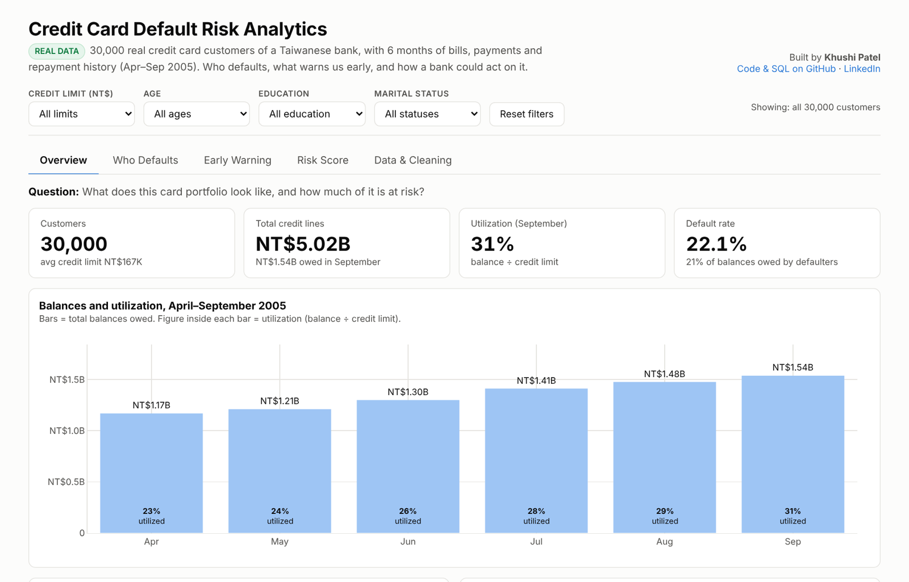](https://khushu-cs.github.io/credit-card-default-risk-analytics/)

**In the dashboard:** 5 tabs (Overview · Who Defaults · Early Warning · Risk Score · Data & Cleaning), filters for credit limit, age, education and marital status, and a **risk cutoff simulator**.

---

## The data (real, public)

| | |
|---|---|
| **Source** | Yeh, I. (2009). *Default of Credit Card Clients* [Dataset]. UCI Machine Learning Repository. [doi.org/10.24432/C55S3H](https://doi.org/10.24432/C55S3H) · CC BY 4.0 |
| **What** | 30,000 real card holders: credit limit, demographics, 6 monthly bills, 6 monthly payments, 6 monthly repayment-status codes (Apr–Sep 2005), and whether they defaulted in October 2005 |
| **Currency** | New Taiwan dollars (NT$). In 2005, US$1 was roughly NT$32 |
| **Context** | Collected during Taiwan's 2005–06 credit card debt crisis, which explains the very high 22% default rate |

## The business problem

A card issuer's risk team needs to answer four questions:

| # | Question | Who uses the answer |
|---|---|---|
| 1 | What does the portfolio look like, and how much is at risk? | Portfolio management |
| 2 | Which customers default most? | Credit policy |
| 3 | What behaviour warns us before a default? | Collections |
| 4 | Can we score every customer, and what should we do with each score? | Risk strategy |

---

## Step 1: Cleaning real, messy data

The raw file had 12 issues. Each one is counted, fixed or flagged, and logged in [`reports/data_quality.csv`](reports/data_quality.csv). The main ones:

| Issue found | Rows | What I did |
|---|---|---|
| Education codes 0, 5, 6 and marital code 0 are not documented | 345 / 54 | Grouped as "Unknown" |
| Repayment codes -2 and 0 are not documented | 120,334 | Used the common interpretation: -2 = no balance, 0 = revolving (not late) |
| "1 month late" recorded 3,688 times in September but only 34 times in Apr–Aug | 3,722 | Month-to-month trends use **2+ months late**, which is recorded consistently |
| Negative bills (customer overpaid) | 3,932 | Kept and flagged; utilization floored at 0 |
| Bill above credit limit | 8,274 | Kept and flagged as over-limit |
| Columns named PAY_0, PAY_2…PAY_6 (no PAY_1) | 6 | Renamed so months line up |

The data was then reshaped from one wide row per customer into two analysis tables: **customers** (30,000 rows) and **monthly statements** (180,000 rows).

---

## Key findings

| Area | Finding | Recommendation |
|---|---|---|
| **Portfolio** | Balances grew **32% in six months** (NT$1.17B → NT$1.54B) and utilization rose from **23% to 31%**. **22.1%** of customers defaulted. | Treat rising utilization as an early portfolio-level warning |
| **Who defaults** | Credit-line size is the clearest profile signal: **32%** default at NT$50K or less vs **12%** above NT$400K. Age, education and marital status differences are small. | Base decisions on behaviour, not demographics (which fair-lending rules restrict anyway) |
| **Early warning** | One month late raises default risk from **~13% to 34%**; two months late raises it to **69%**. Customers late in 4+ of 6 months default **64%** of the time. | Act on the *first* missed payment |
| **Where the money is** | Customers behind on payments are **32%** of customers but hold **64%** of defaulted balances | Focus collections there first |
| **Risk score** | A behaviour-only model ranks risk well on unseen customers (**AUC ≈ 0.76**, cross-validated). The riskiest **20%** contain about **half** of all defaulters. | Use tiers to target effort |
| **Risk tiers** | High + Very high tiers = **25%** of customers but **57%** of defaulters. Predicted and actual default rates match closely in every tier. | Low tier (17% of customers, 7.3% default) → credit-line increases; Very high → reduce available credit |

**A surprise worth reporting:** customers who paid in full defaulted *slightly more often* (12.5%) than minimum payers (11.2%). Real data doesn't always match the textbook, and I report it rather than hide it.

---

## Analysis

### 1. Portfolio trend
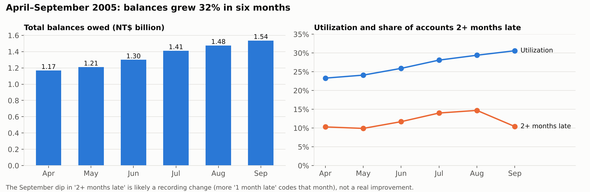

### 2. Who defaults
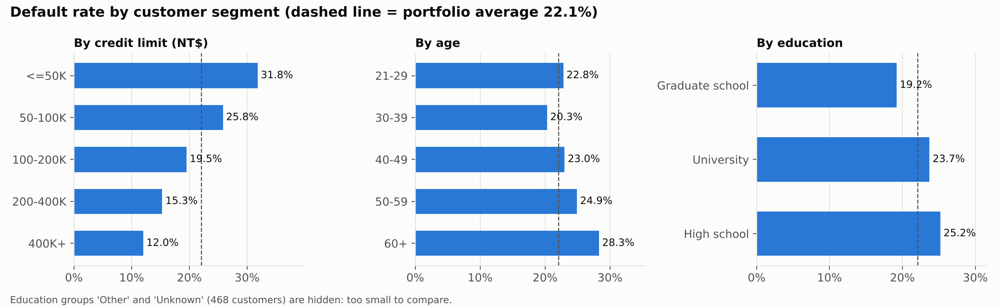
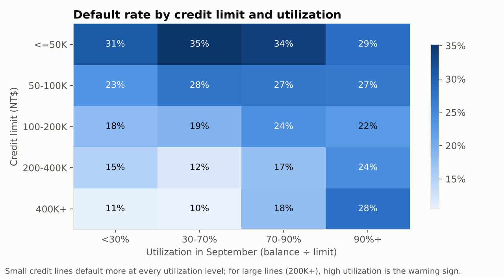

For large credit lines (NT$200K+), high utilization is the warning sign: customers using 90%+ of the line default about **25%** of the time, compared with about **14%** for those using under 30%.

### 3. Early warning signs
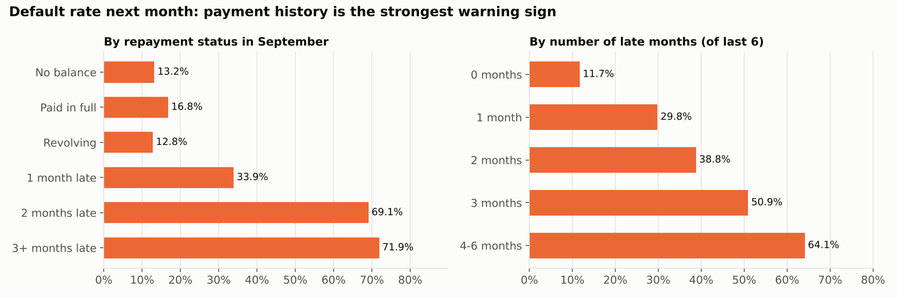
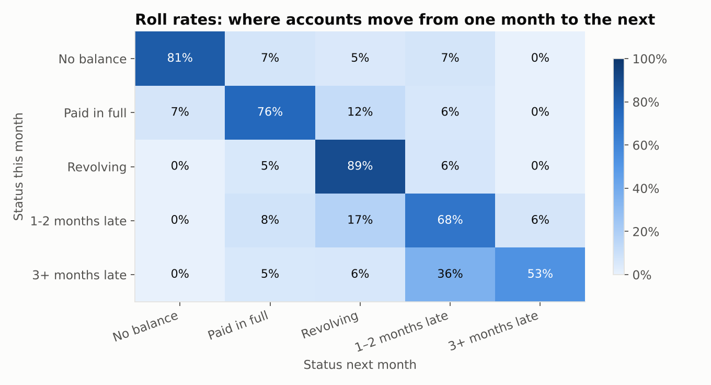

**Roll rates** show where accounts move from one month to the next. Only **25%** of accounts that are 1–2 months late catch up the following month.

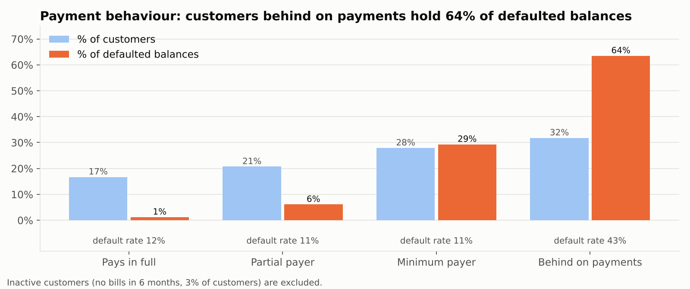

### 4. Risk score
A **logistic regression** "behaviour score", similar to the scores banks use for existing accounts:
- **Inputs:** months late, number of late months, worst delay, utilization, share of bills paid, credit limit, inactivity
- **Deliberately excluded:** sex, age, education and marital status (fair lending, and behaviour is the stronger signal)
- **Evaluation:** 5-fold cross-validation AUC **0.76** (range 0.75–0.77 across folds). On the 30% held-out test set: AUC **0.75** · Gini **0.51** · KS **0.40**

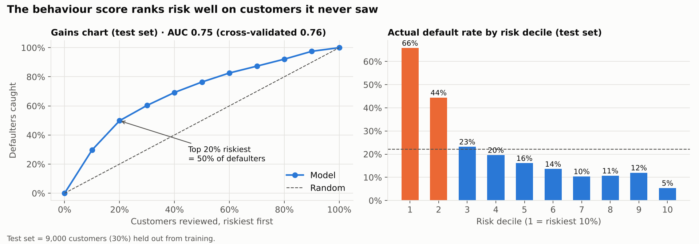
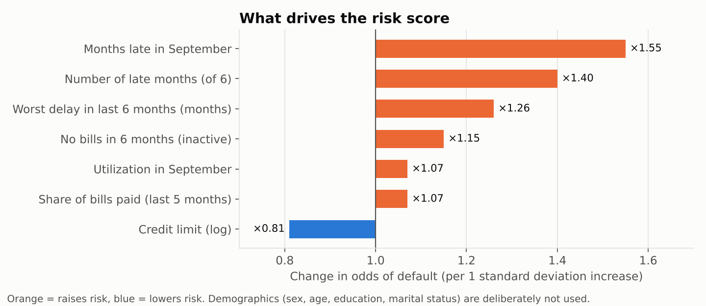
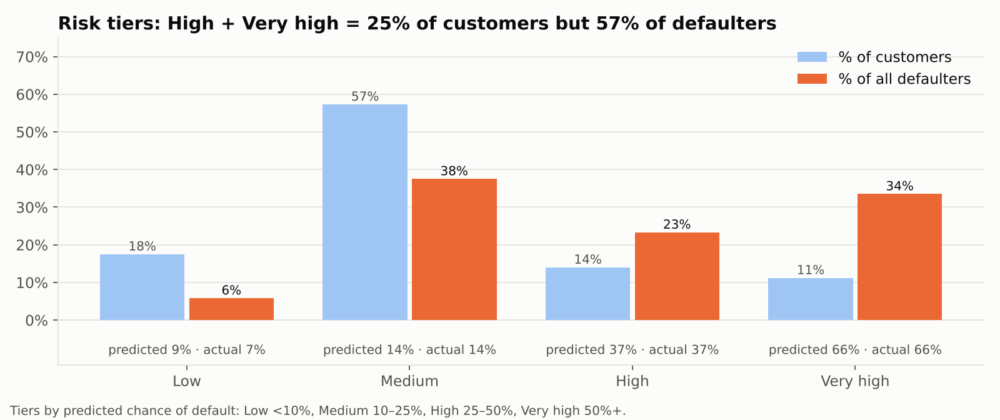

The dashboard's **risk cutoff simulator** shows the trade-off a bank faces when it picks a threshold:

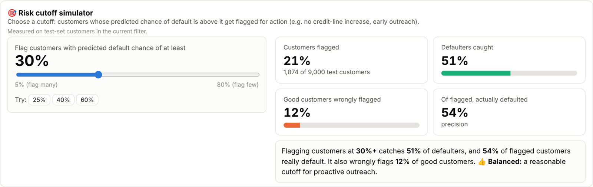

---

## SQL techniques used

| File | Business question | Techniques |
|---|---|---|
| [`00_setup.sql`](sql/00_setup.sql) | Customer-level feature table | CTEs, `FILTER` aggregates, `LEAD()`, `CASE` segmentation |
| [`01_portfolio_overview.sql`](sql/01_portfolio_overview.sql) | Headline KPIs | Conditional aggregation |
| [`02_default_by_segment.sql`](sql/02_default_by_segment.sql) | Default by segment | `UNION ALL` across dimensions |
| [`03_monthly_trend.sql`](sql/03_monthly_trend.sql) | Month-by-month movement | Time-series aggregation |
| [`04_roll_rates.sql`](sql/04_roll_rates.sql) | Roll-rate transition matrix | `LEAD()` over customer partitions |
| [`05_early_warning.sql`](sql/05_early_warning.sql) | Signals before default | Banding, `UNION ALL` |
| [`06_utilization_by_limit.sql`](sql/06_utilization_by_limit.sql) | Utilization × limit heatmap | Two-way grouping |
| [`07_payment_behaviour.sql`](sql/07_payment_behaviour.sql) | Behaviour segments & money at risk | Window functions for share-of-total |
| [`08_exposure_by_limit.sql`](sql/08_exposure_by_limit.sql) | Where defaulted balances sit | `FILTER` + window totals |
| [`09_risk_tiers.sql`](sql/09_risk_tiers.sql) | Model calibration by tier | Join model output to features |
| [`10_tier_actions.sql`](sql/10_tier_actions.sql) | Action plan per tier | Profile aggregation |

---

## Project structure

```
├── data/
│   ├── raw/default_of_credit_card_clients.xls   # original UCI file, untouched
│   └── clean/                                   # customers, statements, risk_scores (CSV)
├── sql/                     # 00_setup + 10 business questions
├── src/
│   ├── clean_data.py        # raw → clean tables + data quality log
│   ├── run_sql.py           # runs every SQL file → reports/results/
│   ├── train_model.py       # behaviour score: train, test, score customers
│   ├── make_charts.py       # charts for this README
│   ├── dashboard_data.py    # data for the dashboard
│   ├── dashboard_template.html  # dashboard layout, filters, simulator
│   ├── build_dashboard.py   # → docs/index.html
│   ├── export_powerbi.py    # star schema for Power BI → powerbi/data/
│   └── build_notebook.py    # builds & runs the notebook
├── notebooks/analysis.ipynb # walkthrough from raw file to risk score
├── reports/
│   ├── executive_summary.md
│   ├── data_quality.csv
│   └── results/             # output of every query and the model
├── powerbi/                 # Power BI guide + data
├── images/                  # charts
└── docs/index.html          # interactive dashboard (GitHub Pages)
```

## How to run it

```bash
git clone https://github.com/khushu-cs/credit-card-default-risk-analytics.git
cd credit-card-default-risk-analytics
pip install -r requirements.txt

python src/clean_data.py       # 1. clean the raw file
python src/train_model.py      # 2. train & evaluate the risk score
python src/run_sql.py          # 3. run all SQL analyses
python src/make_charts.py      # 4. charts
python src/build_dashboard.py  # 5. dashboard
```

## Limitations

- **Six months only:** no long-term trends, seasonality or account age.
- **No transaction or fraud data:** banks don't publish it for privacy reasons.
- **Undocumented codes:** I interpreted repayment codes -2 and 0 the common way; the source doesn't define them.
- **Unexplained records:** 866 customers had no bills for six months, yet 37% are marked as defaulting. In a real job I'd raise this with the data owner.
- **2005 Taiwan:** default levels are far higher than in a typical US portfolio today. The *patterns* and *methods* transfer; the levels don't.

---

**Khushi Patel** · Data Analyst · [LinkedIn](https://www.linkedin.com/in/khushi-patel-458190285) · [GitHub](https://github.com/khushu-cs)
